# Heart Disease MLOps Platform

**Course:** Machine Learning Operations (MLOps), AIMLCZG523  
**Assignment:** 01 — End-to-end ML model development, CI/CD, and production deployment  
**Dataset:** UCI Heart Disease, repository id 45

This report covers the full path that was built: download and clean the data, exploratory plots, two tuned classifiers, MLflow, an ONNX package, pytest and GitHub Actions, a FastAPI service in Docker, a local Minikube deployment, and Prometheus with Grafana. The figures below are the plots and screenshots already saved in this repository. Layout and wording can be tightened later.

**Code repository:** add the GitHub URL here after the repo is pushed.

**Demo video:** `recordings/merged_recording.mkv` (the short walkthrough of the pipeline).

---

## 1. What the system does

The task is a binary classifier: given 13 clinical measurements, predict whether heart disease is present. Training stays in scikit-learn. Serving does not unpickle that object. The chosen pipeline is exported to ONNX and executed inside the API by ONNX Runtime.

The pieces and where they live:

| Piece | Where it lives |
|---|---|
| Download, clean, EDA, training | `src/mlops/` started by `python -m mlops.main` |
| Settings | `configs/config.yaml` |
| Cleaned tables and plots | `data/cleaned/`, `reports/figures/` |
| Experiment log | MLflow experiment `heart-disease`, SQLite file `mlflow.db` |
| Packaged model | `models/heart_disease.onnx` |
| Tests | `tests/` |
| CI | `.github/workflows/ci.yml` |
| API image | `Dockerfile`, image name `heart-api:local` |
| Cluster | `k8s/` on Minikube (no Helm chart) |
| Metrics | Prometheus scrapes `/metrics`; Grafana dashboard **Heart Disease API** |

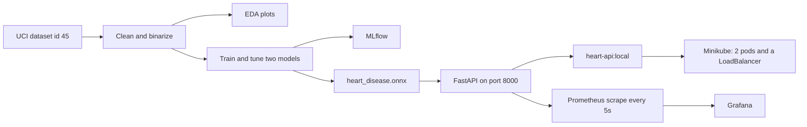

---

## 2. Setup

Python 3.12. From the project root:

```bash
python -m venv venv
source venv/bin/activate
pip install -r requirements.txt
```

`requirements.txt` pins the stack used for both training and the container: pandas, scikit-learn, matplotlib, seaborn, MLflow, skl2onnx, onnxruntime, FastAPI, uvicorn, prometheus-client, pytest, and ruff.

Train, test, and open the experiment UI:

```bash
PYTHONPATH=src python -m mlops.main
PYTHONPATH=src pytest tests/ -q
mlflow ui --backend-store-uri sqlite:///mlflow.db
```

Training writes `data/cleaned/`, `reports/figures/`, `models/heart_disease.onnx`, and the MLflow store. The API, without Docker:

```bash
PYTHONPATH=src uvicorn mlops.api:app --host 0.0.0.0 --port 8000
```

Docker and the cluster are in sections 8 and 9. A clean machine only needs the requirements file, then these commands. GitHub Actions repeats lint, test, and train on its own runner.

---

## 3. Data

The loader is `src/mlops/data_loader.py`. It calls `ucimlrepo.fetch_ucirepo(id=45)` and saves `data/raw/heart_disease.csv` if that file is not already there. The raw table has 303 rows and 14 columns: 13 inputs plus `target`.

The original `target` is the angiographic status `num`, coded 0 to 4, not a binary label:

| Code | Rows |
|---|---|
| 0 (no disease) | 164 |
| 1 | 55 |
| 2 | 36 |
| 3 | 35 |
| 4 | 13 |

Missing values are only in `ca` (4 rows) and `thal` (2 rows). Those six rows are dropped. `ca` and `thal` are then stored as integers. The target is binarized: 0 stays “no disease”, and any value above 0 becomes “disease”. That is `Preprocessor.clean` in `src/mlops/preprocessing.py`.

After cleaning, `data/cleaned/heart_disease.csv` has **297 rows**:

| Class | Rows | Share |
|---|---|---|
| 0, no disease | 160 | 53.9% |
| 1, disease | 137 | 46.1% |

The classes are close enough that accuracy is usable, but ROC-AUC is the score used to pick the model so a small shift in the threshold does not decide the winner.

Column meaning, as used by the API:

| Column | Meaning |
|---|---|
| age | Age in years |
| sex | 1 male, 0 female |
| cp | Chest-pain type |
| trestbps | Resting blood pressure |
| chol | Serum cholesterol |
| fbs | Fasting blood sugar above 120 mg/dl (1 or 0) |
| restecg | Resting electrocardiogram |
| thalach | Maximum heart rate achieved |
| exang | Exercise-induced angina (1 or 0) |
| oldpeak | ST depression induced by exercise |
| slope | Slope of the peak exercise ST segment |
| ca | Number of major vessels colored by fluoroscopy |
| thal | Thalassemia / defect code |
| target | 0 no disease, 1 disease |

Numeric summary of the cleaned table: age averages 54.5 years (29 to 77), resting blood pressure 131.7, cholesterol 247.4, maximum heart rate 149.6, and oldpeak 1.1.

---

## 4. Exploratory analysis

`src/mlops/eda.py` writes the figures into `reports/figures/` before the split, then writes the train-versus-test figures after the split. The same images are copied under `screenshots/` for the submission folder.

Class balance on the cleaned 297 rows. The two classes are close, with a small majority of patients who have no disease.

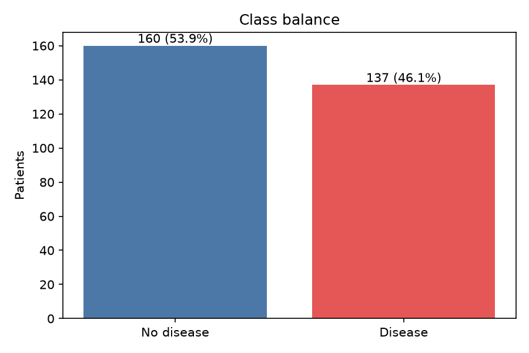

Histograms of age, resting blood pressure, cholesterol, maximum heart rate, oldpeak, and `ca`. Cholesterol and oldpeak are right-skewed. `ca` is a small integer, mostly 0.

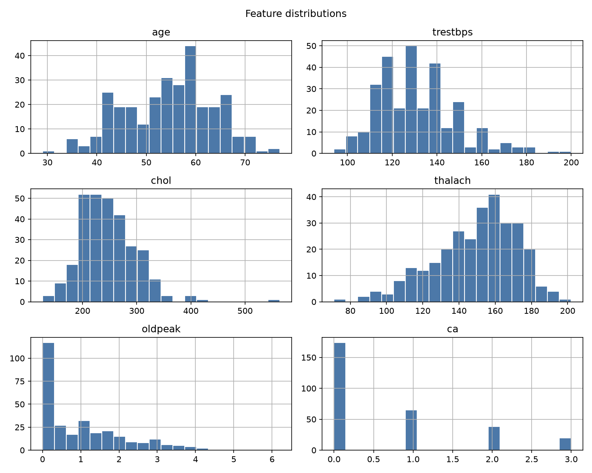

Correlation of the numeric columns with each other and with the target. The strongest links with disease in this table are `thal` (0.53), `ca` (0.46), `oldpeak` (0.42), `exang` (0.42), and `cp` (0.41). Maximum heart rate moves the other way (`thalach` −0.42): higher recorded peaks sit with the no-disease class. Fasting blood sugar is almost unrelated (0.00). These signs match the usual reading of this dataset, and they are why `ca`, `thal`, `oldpeak`, and heart rate stay in the model.

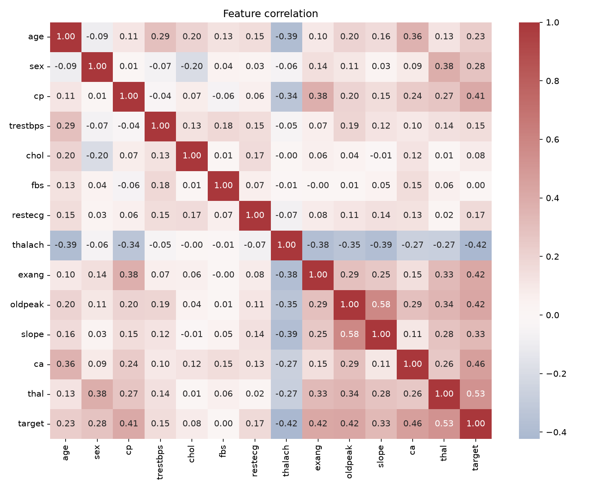

---

## 5. Features, split, and the two models

The split is in `ModelTrainer.train`. It is a stratified 80/20 split, `random_state` 42, so each side keeps the same disease rate. Saved files: `data/cleaned/train.csv` (237 rows) and `data/cleaned/test.csv` (60 rows).

| Split | Rows | No disease | Disease |
|---|---|---|---|
| Train | 237 | 128 (54.0%) | 109 (46.0%) |
| Test | 60 | 32 (53.3%) | 28 (46.7%) |

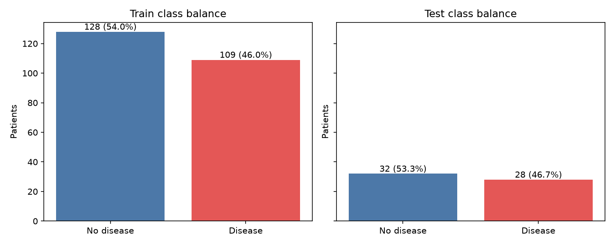

The feature histograms on the two splits overlap. The test set is small (60 rows), so a few bins differ, but there is no obvious shift that would make the holdout unusable.

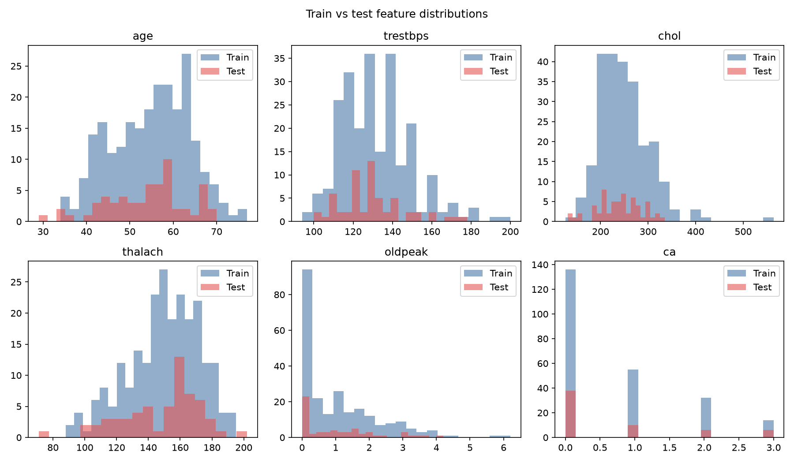

The model does not see raw columns. Each candidate is a scikit-learn `Pipeline`:

1. **Numeric** — `StandardScaler` on age, trestbps, chol, thalach, oldpeak, and ca.
2. **Categorical** — `OneHotEncoder(drop="first", handle_unknown="ignore")` on cp, restecg, slope, and thal.
3. **Binary** — sex, fbs, and exang passed through unchanged. They are already 0/1.

Scaling and one-hot encoding are fit only on the training folds inside the pipeline, so the test rows do not leak into the scaler.

Two classifiers, both tuned with `GridSearchCV`, 5-fold stratified CV, scoring `roc_auc`:

| Model | Grid |
|---|---|
| Logistic regression (`max_iter` 1000) | `C` in {0.1, 1.0, 10.0} |
| Random forest | `n_estimators` in {100, 200}, `max_depth` in {3, 5, 10} |

Logistic regression is the linear baseline: coefficients are readable and it is hard to overfit on 237 rows if `C` is not huge. Random forest is the non-linear comparison and can use interactions such as vessel count with ST depression. The search picks depth and tree count instead of leaving the forest at the library default, which would memorize the training set.

After the search, the best pipeline of each model is scored again with `cross_validate` on accuracy, precision, recall, and ROC-AUC. The holdout is scored once, after selection, and is not used to choose the winner.

**Winner rule:** the model with the higher cross-validated ROC-AUC is exported. On the finished run that wrote `models/heart_disease.onnx`, that is the random forest.

### Cross-validation on the training set (5-fold mean)

| Metric | Logistic regression (`C` = 0.1) | Random forest (100 trees, depth 3) |
|---|---|---|
| Accuracy | 0.818 | 0.823 |
| Precision | 0.843 | 0.876 |
| Recall | 0.742 | 0.723 |
| ROC-AUC | 0.893 | **0.904** |

### Holdout (60 patients), not used for selection

| Metric | Logistic regression | Random forest |
|---|---|---|
| Accuracy | 0.850 | 0.817 |
| Precision | 0.880 | 0.870 |
| Recall | 0.786 | 0.714 |
| ROC-AUC | 0.953 | 0.952 |

The forest wins the selection metric by about 0.01 AUC. On the 60-row holdout the logistic model has higher accuracy and recall, and the two AUCs are almost the same (0.953 and 0.952). That gap is expected: the holdout is small, and a depth-3 forest is slightly more conservative (higher precision, lower recall). The export still follows the rule written in code, which is cross-validated ROC-AUC, so the API serves the random forest. Both ROC-AUCs near 0.90 under CV, and near 0.95 on this particular holdout, are strong for 13 clinical fields. Recall around 0.72 means some disease cases are missed; for a screening story that would be the number to push on next, for example with a lower decision threshold. This submission keeps the default 0.5 threshold.

Training-set scores for the forest (accuracy 0.882, ROC-AUC 0.954) sit above the CV scores, which is normal, and the depth cap of 3 keeps that gap modest.

---

## 6. Experiment tracking

MLflow 3.16 is the experiment log. The tracking URI is the SQLite file `mlflow.db`. The UI is only a view of that file:

```bash
mlflow ui --backend-store-uri sqlite:///mlflow.db
```

The experiment name is `heart-disease`. One parent run is called `compare-models`. Each model is a nested run, `logistic_regression` and `random_forest`. The finished parent used for the figures below is run `e61b096834604696ac7b1f2ddd338645` (about 30 seconds, status Finished, source `main.py`). Its note records 237 train rows and 60 validation rows, with the class counts above.

What each run stores:

- Parameters, including the chosen `C` or `max_depth` and `n_estimators`.
- CV metrics and holdout accuracy, precision, recall, ROC-AUC, and average precision.
- Train and validation class counts.
- System metrics (CPU, memory, disk), because system-metric logging is turned on.
- The fitted pipeline as an MLflow sklearn model.
- ROC, precision-recall, and confusion-matrix figures for train and validation.
- Artifacts: raw and cleaned CSVs, the split, `config.yaml`, `requirements.txt`, and the EDA figures.
- The ONNX file, logged on the parent run under `onnx/`.

The compare page in the UI. This particular screenshot is an earlier side-by-side of the autolog metrics (random forest ROC-AUC 0.909, logistic regression 0.905). The parameters match the final search: forest depth 3 and 100 trees, logistic `C` 0.1. The table in section 5 is the later `cross_validate` log that the export uses.

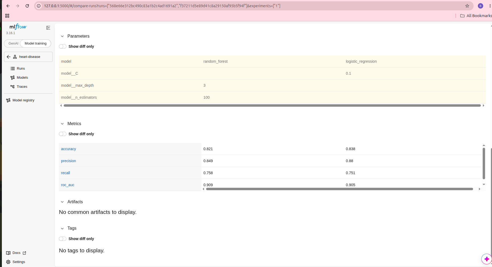

Parent run overview: train and validation counts, system metrics, and the logged dataset `heart_disease_train`.

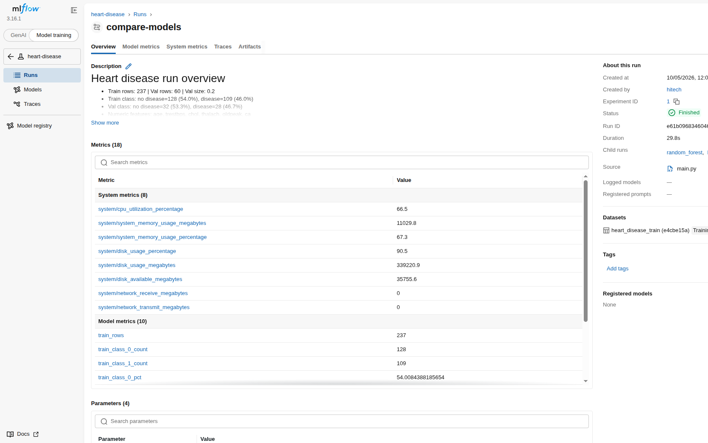

---

## 7. Packaging

`skl2onnx.convert_sklearn` converts the winning pipeline, scaler and one-hot encoder included, to ONNX. Inputs are one float tensor per column, which is how ONNX Runtime wants the 13 fields. The file is `models/heart_disease.onnx`.

`src/mlops/predict.py` loads that file with ONNX Runtime. It checks that all 13 names are present, runs the session, and returns:

```json
{"prediction": 0, "probability": 0.336}
```

`prediction` is 0 or 1. `probability` is the score for class 1. The sample row from the API form (age 63, sex 1, cp 1, trestbps 145, chol 233, fbs 1, restecg 2, thalach 150, exang 0, oldpeak 2.3, slope 3, ca 0, thal 6) scores as **no disease, probability 0.336**.

Serving never unpickles the scikit-learn object. Training still uses scikit-learn. That split is what makes the Docker image independent of the MLflow store.

---

## 8. Tests and CI

Pytest covers the four behaviours the pipeline has to keep:

| File | What it checks |
|---|---|
| `tests/test_data.py` | Missing `ca`/`thal` rows are dropped, the target becomes 0/1, one-hot removes `cp`, and a CSV on disk loads |
| `tests/test_model.py` | Both model names exist, the preprocessor has numeric, categorical, and binary steps, and each model can fit and predict 0/1 |
| `tests/test_predict.py` | The ONNX file returns a class and a probability in [0, 1] |
| `tests/test_api.py` | `/` contains the title, `/health` is ok, `/monitor` and `/metrics` expose `heart_api_requests_total`, and POST `/predict` returns a class and a probability |

GitHub Actions runs `.github/workflows/ci.yml` on every push and pull request, on `ubuntu-latest`, not on the laptop:

1. Checkout.
2. Python 3.12 and `pip install -r requirements.txt`.
3. `ruff check src tests`. The job fails if lint fails.
4. `PYTHONPATH=src pytest tests/ -q`.
5. `PYTHONPATH=src python -m mlops.main`, which retrains and rewrites the ONNX file.
6. Upload `models/heart_disease.onnx`, `reports/figures`, and `mlflow.db` as the artifact `pipeline-artifacts`, including when a later step fails (`if: always()`).

There is no Actions screenshot in `screenshots/` yet. Paste the green workflow run here when you beautify the report.

---

## 9. API and Docker

FastAPI is the application. Uvicorn is the process that listens on port 8000. A Pydantic model checks the 13 fields before they reach the predictor (`sex`, `fbs`, and `exang` must be 0 or 1).

| Method | Path | Behaviour |
|---|---|---|
| GET | `/` | HTML form |
| GET | `/predict` | Lists the 13 feature names and says the method is POST |
| POST | `/predict` | JSON in, `prediction` and `probability` out |
| GET | `/health` | `{"status": "ok", "model_path": ...}` |
| GET | `/monitor` | Last requests: method, path, status, latency in milliseconds |
| GET | `/metrics` | Prometheus text |
| GET | `/docs` | OpenAPI page |

The form page. Submitting it sends POST `/predict` and prints the JSON under the form.

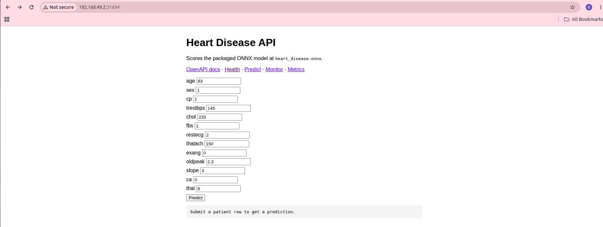

GET `/predict` on the cluster address `http://192.168.49.2:31694/predict`. This is the contract, not a scored patient. A scored patient is the POST described in section 7.

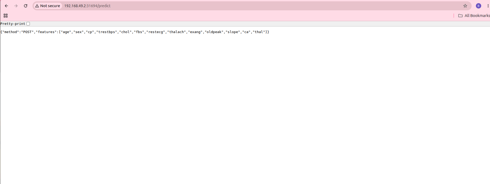

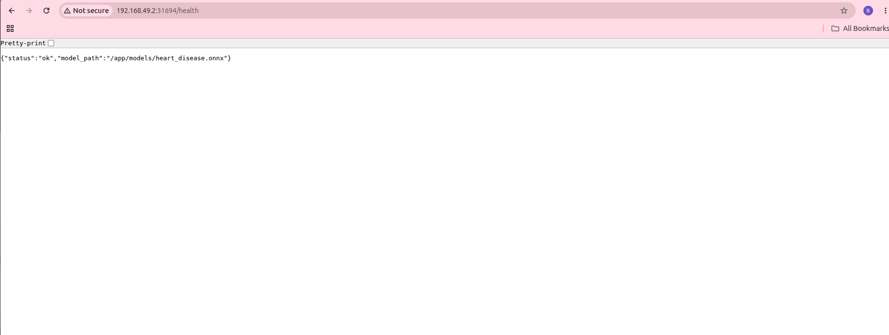

The image is `heart-api:local`, built from `Dockerfile`:

1. Base image `python:3.12-slim`.
2. `pip install -r requirements.txt`.
3. Copy `src/`, `configs/`, and `models/heart_disease.onnx`.
4. `uvicorn mlops.api:app --host 0.0.0.0 --port 8000`.

```bash
docker build -t heart-api:local .
docker run --rm -p 8000:8000 heart-api:local
```

The image is the packed filesystem. The container is a running copy of it. Kubernetes never reads the laptop’s `src/` folder; it only runs what was copied into the image.

---

## 10. Kubernetes

Production deployment for this assignment is local Kubernetes with Minikube and the Docker driver. There is no Helm chart. The brief allows a deployment manifest or a Helm chart; `k8s/` is the manifest set.

```bash
minikube start --driver=docker
minikube image load heart-api:local
kubectl apply -f k8s/
kubectl get pods,svc
minikube service heart-api --url
```

`minikube image load` is required because Minikube has its own Docker. `imagePullPolicy: Never` on the API pods means “use the image that was loaded, do not pull it from the internet.”

`k8s/deployment.yaml` starts **two** replicas of `heart-api:local` on port 8000. Two copies means one pod can restart while the other still serves. Readiness and liveness probes are HTTP GET `/health`. If `/health` fails, Kubernetes restarts that pod.

`k8s/service.yaml` is a LoadBalancer on port 8000. The service is the stable address in front of the two pods, and it spreads traffic across them. On this Minikube node the service is also reachable as NodePort **31694**.

`kubectl get pods,svc` from the cluster used for the screenshots:

| Name | Ready | Status | Address |
|---|---|---|---|
| heart-api (two pods) | 1/1 | Running | 10.244.0.7 and 10.244.0.8 |
| prometheus | 1/1 | Running | 10.244.0.6 |
| grafana | 1/1 | Running | 10.244.0.5 |

Services are type LoadBalancer. The external IP stays `<pending>` on Minikube without `minikube tunnel`; the NodePorts still open:

| Service | Port | NodePort used in the browser |
|---|---|---|
| heart-api | 8000 | 31694 |
| prometheus | 9090 | 30275 |
| grafana | 3000 | 31957 |

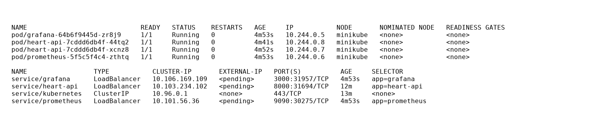

The same form, opened at `minikube service heart-api --url`, posts to `/predict` inside the cluster. Pod logs show the same line the process logger writes, for example `POST /predict -> 200 in 13.2ms`:

```bash
kubectl logs -l app=heart-api --tail=50
```

---

## 11. Logging, Prometheus, and Grafana

Every API request except `/metrics` is recorded by `RequestMonitor` in `src/mlops/monitor.py`.

- A log line: method, path, status code, latency in milliseconds. `kubectl logs` shows it.
- The same events stay in memory (last 100) and are rendered on `/monitor`.
- Two Prometheus series, via the client library: counter `heart_api_requests_total` (labels method, path, status) and histogram `heart_api_request_latency_seconds` (labels method, path).

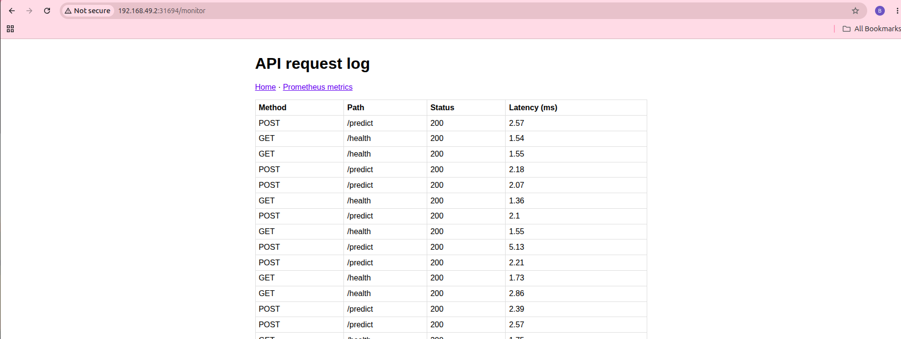

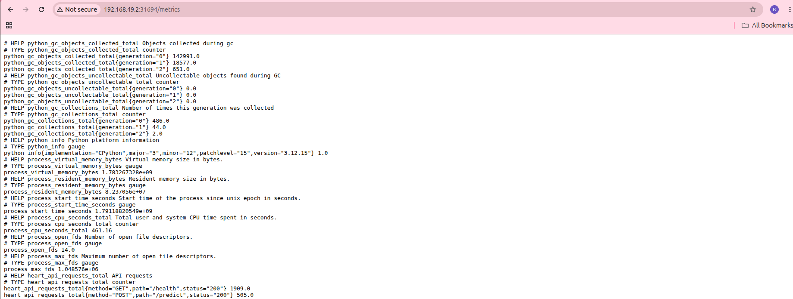

Prometheus pulls metrics. The app does not push them. `k8s/prometheus.yaml` scrapes `heart-api:8000/metrics` every 5 seconds (Prometheus 3.2.1). On Status → Targets the job `heart-api` is **1/1 up**, endpoint `http://heart-api:8000/metrics`, last scrape about 8 ms.

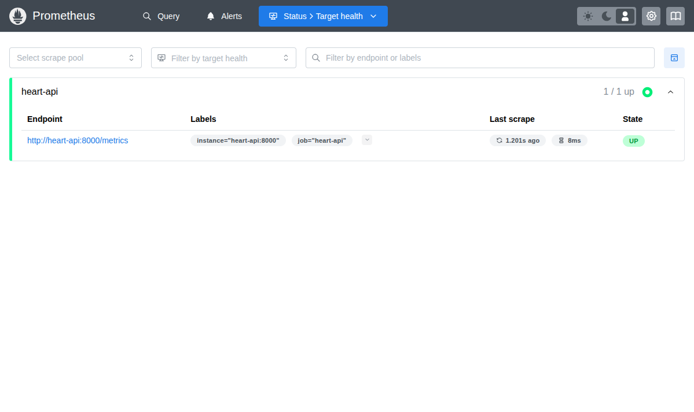

Grafana does not scrape the API. It queries Prometheus. `k8s/grafana.yaml` (Grafana 11.6.0) provisions:

- Datasource **Prometheus** at `http://prometheus:9090`.
- Dashboard **Heart Disease API** with two panels: request rate `sum(rate(heart_api_requests_total[1m]))` by path and status, and p95 latency from `heart_api_request_latency_seconds_bucket`.
- Login `admin` / `admin`. Sign-up is off.

The dashboard below is the last five minutes on `http://192.168.49.2:31957`. Request rate is mostly `/health` (the probes) and `/predict` with status 200. p95 for `/predict` sits around 5–7 ms. A short 404 series appears where a missing path was requested. Submit the form, or POST `/predict`, so those series are not empty. The probes already call `/health`.

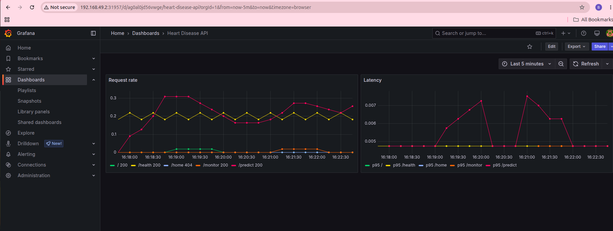

---

## 12. How to reproduce the deployment

From a clean checkout, with Docker, Minikube, and kubectl installed:

```bash
python -m venv venv && source venv/bin/activate
pip install -r requirements.txt
PYTHONPATH=src python -m mlops.main
PYTHONPATH=src pytest tests/ -q
docker build -t heart-api:local .
minikube start --driver=docker
minikube image load heart-api:local
kubectl apply -f k8s/
minikube service heart-api --url
minikube service prometheus --url
minikube service grafana --url
```

The public-cloud URL is not used. Access for marking is the Minikube service URL above, plus this repository. Stop the cluster with `minikube stop`. Start it again with `minikube start --driver=docker`. Reload the image only after a rebuild.

---

## 13. What was delivered

- Download script and cleaned dataset (`data/raw`, `data/cleaned`, 297 rows).
- EDA figures: class balance, histograms, correlation, and the train/test checks.
- Two tuned models. Random forest (depth 3, 100 trees) is the packaged model because its CV ROC-AUC is 0.904 against 0.893 for logistic regression.
- MLflow logs for parameters, metrics, plots, and files.
- `requirements.txt`, the ONNX file, and the preprocessing pipeline inside that file.
- Pytest and a GitHub Actions workflow that lints, tests, trains, and uploads artifacts.
- Docker image `heart-api:local` with POST `/predict`.
- Minikube manifests: two replicas, LoadBalancer, health probes.
- Request logs, Prometheus, and a Grafana dashboard.
- Screenshots in `screenshots/` and this report.
- A short pipeline video at `recordings/merged_recording.mkv`.

Add the GitHub repository link in the header, and a screenshot of the green Actions run, when the repo is pushed.
